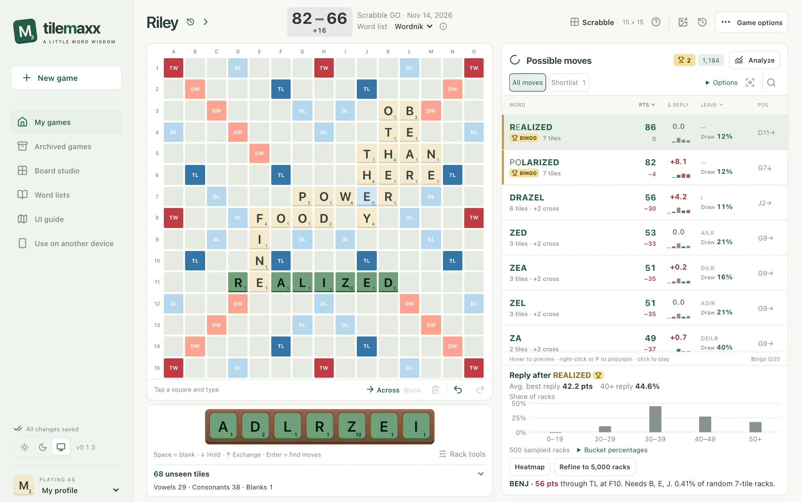
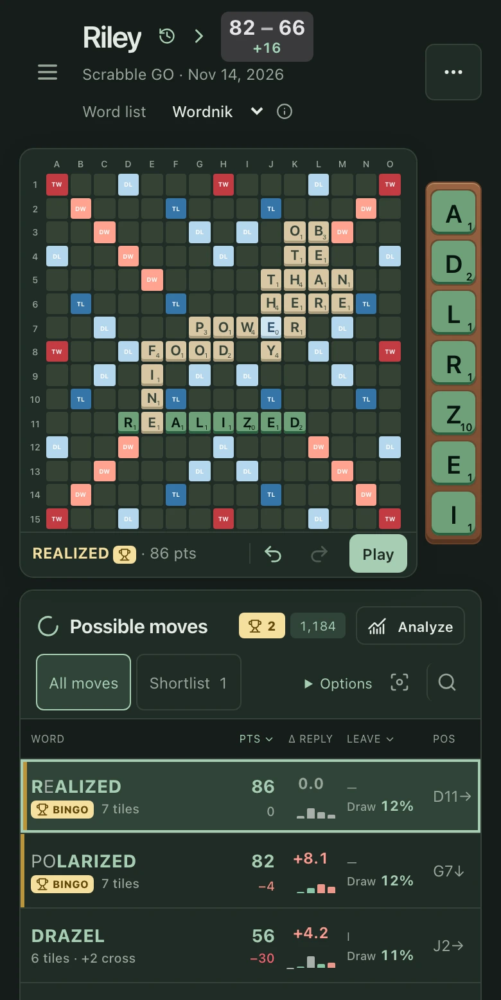
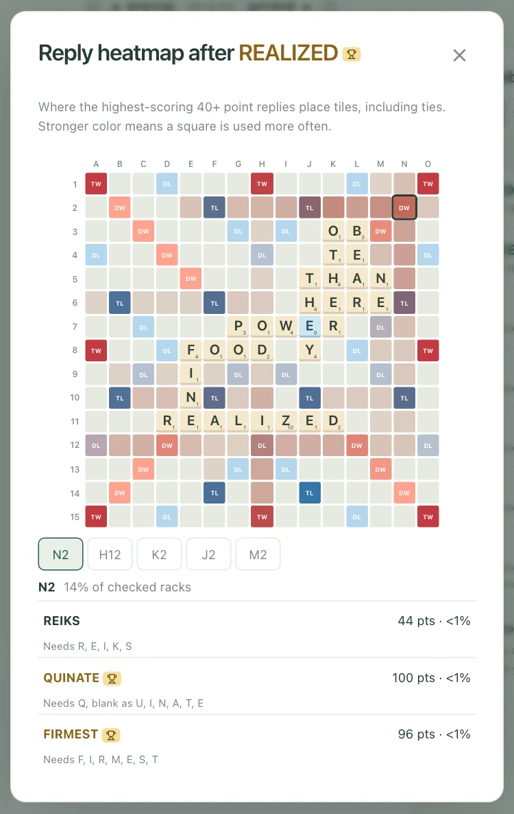

# Tilemaxx

**Spot the bingo you almost missed.** Tilemaxx is a self-hosted Scrabble solver. Enter your board and rack, or start from a screenshot, then preview your best moves and see what your opponent could play back.

[Run locally](#run-locally) · [Docker Compose](#deploy-with-docker-compose) · [Word lists](#word-lists)



## Find your next move

1. Choose a board and word list.
2. Type the played tiles or import a Scrabble GO or Wordfeud screenshot and review the result.
3. Enter your rack and select **Find moves**. Hover over a move on desktop or tap it on your phone to preview it.

## Beyond the highest score

- **Compare plays.** Check rack leave, bingo odds, and where strong replies could land. With an empty bag, calculate the best endgame line.
- **Pick up on another device.** Boards, racks, and tracked scores save to your local server. Review turns with their original board and rack.
- **Choose your rules.** Play on Scrabble, Super Scrabble, Words With Friends, Wordfeud, NYT Crossplay, or Lexulous layouts, or build your own.

<p>
  <a href="docs/screenshots/phone-preview.webp"></a>
  <a href="docs/screenshots/reply-heatmap.webp"></a>
</p>

Open **UI guide** from the sidebar for annotated screenshots or read the [UI guide](docs/ui-guide.md).

<details>
<summary>Board, rack, and game controls</summary>

- **Board.** Select a square and type to advance in the current direction. Use Right or Down to switch direction, or tap the selected square again. Type a dot to skip a square and Space followed by a letter to place a blank. Hover over a played tile or hold it on a phone to check word scores.
- **Rack.** Select any slot to edit it. Space or `?` enters a blank, Delete clears the current slot, and Enter finds moves. Use **Rack tools** to hold tiles out of the search or simulate an exchange. **Unseen tiles** shows the combined tiles in the bag and other racks.
- **Screenshot import.** PNG, JPEG, WebP, HEIF, and HEIC are supported. Adjust the grid if needed and compare the recognized board with the original. Enter the rack separately. Import runs locally, preserves the rack, and can be undone.
- **Analysis.** Use **Analyze** to compare up to three plays. The app estimates bingos and opponent replies from the unseen tiles. Set the bag count in **Options** if you know it. When the bag is empty, Tilemaxx ranks moves by endgame swing and can search for an optimal line with the rules of your game. For Crossplay, clear **Opponent has a final turn** if they have already taken it.
- **Saved games.** Undo and redo board changes and plays. Switch games from the game title, duplicate a game to try an alternative, or archive a finished game. Wait for **All changes saved** before switching devices. If edits collide, you can keep the server version or save your local version as a separate game.

</details>

## Run locally

Install [Node.js](https://nodejs.org/) 22.13 or later. The project uses Node 24 LTS in CI and Docker. From the checkout, run:

```sh
npm ci
npm run dev
```

Open [http://localhost:4173](http://localhost:4173). On another device on your network, use the host computer’s LAN address with port `4173`. On iPhone, Safari’s **Share → Add to Home Screen** creates a shortcut.

For a production build without Docker:

```sh
npm run build
npm start
```

The defaults are `PORT=4173`, `HOST=0.0.0.0`, and `DATA_DIR=./data`. Set `HOST=127.0.0.1` to limit access to the host computer. Tilemaxx has no login or cloud account. Keep it on a trusted local network and leave its port closed to the internet.

## Word lists

Tilemaxx ships with **Wordnik (2021)** and **ENABLE**, so you can try it right away. Choose a list when you create a game. For league or tournament play, install the list your game uses.

- **WOW24.** Download the [WGPO Official Words 2024 list](https://wordgameplayers.org/wgpo-official-words/) and import it under **Word lists**. You can also save it as `data/dictionaries/WOW24.txt` and restart. New games prefer WOW24 when available.
- **CSW24, NWL, and other lists.** Use **Word lists → Import word list** with a text file you have permission to use, with one word per line. Tilemaxx accepts words from 2 to 25 letters and removes duplicates.
- **Words With Friends.** The layout is available as a preset. The bundled ENABLE list differs from the current Words With Friends lexicon.

Imported lists are available to every profile on the server. To remove one, use its trash button in **Word lists**. If a saved game uses that list, choose a different list in the game first. See [THIRD_PARTY.md](THIRD_PARTY.md) for sources and licenses.

## Deploy with Docker Compose

On a host with Git and Docker Compose, run these commands from the folder where you keep your Compose projects.

```sh
git clone https://github.com/buntwo/tilemaxx.git
cd tilemaxx
cp compose.prebuilt.yaml compose.yaml
mkdir -p data
sudo chown 1000:1000 data
```

Uncomment `build: .` in your local `compose.yaml`, then run:

```sh
docker compose up -d --build
```

Open `http://YOUR-HOST-IP:4173` from a device on the same network. If your host uses standalone Compose, substitute `docker-compose` for `docker compose`.

- **Settings.** Set `TILEMAXX_PORT` in a local `.env` file to change the host port. Set `TILEMAXX_CONTAINER_NAME` to override the default `tilemaxx-1` when running multiple instances.
- **Storage.** Compose mounts `./data` at `/app/data`. It contains the SQLite database (`tilewise.sqlite`), imported word lists, and any screenshot examples you explicitly save. The container runs as UID/GID `1000:1000` and needs write access to these files. Git and the Docker build context exclude `data/`.
- **Prebuilt image.** If you already have an image, leave `build: .` commented out, set `image:` to the tag you loaded, and run `docker compose up -d`.

### Update from GitHub

For a checkout-based install with `build: .` enabled, run from the deployment checkout:

```sh
./update.sh
docker compose ps
```

The script fast-forwards the checkout and rebuilds using your local `compose.yaml`. It supports both `docker compose` and standalone `docker-compose`. Your settings and bind-mounted `data/` stay in place.

#### Schedule updates with DSM Task Scheduler

Run `./update.sh` once on the NAS to deploy the current checkout and get the scheduled updater. In **Control Panel → Task Scheduler → Create → Scheduled Task → User-defined script**, set your preferred interval and run this command with the absolute path to your Tilemaxx checkout:

```sh
/bin/bash "/path/to/tilemaxx/update-if-changed-DSM.sh"
```

Use the NAS account that can pull from GitHub and run Docker. Select **Run** once in Task Scheduler to confirm that account can find Git and Docker and access the checkout. In **Task Settings**, enable **Send run details by email** and **Send run details only when the script terminates abnormally**. The script exits with `0` when there is nothing to deploy and reserves `10` for a successful deployment. The email output identifies the deployed revision. Failed runs also send an email with the error output and a different nonzero status. If a command fails with `10`, the script reports it as `1`.

The scheduled script mirrors the checkout’s upstream branch, including force-pushes and rollbacks. Keep the deployment branch free of local commits. The script moves the branch to the upstream revision and stops if that would overwrite local edits to tracked files or change a deployment file tracked by Git. Keep `compose.yaml`, `.env`, and `data/` local as described above.

The scheduled script skips Docker entirely when the checkout is current. If the checkout moves to a different revision and Compose fails, the next run retries that deployment. A lock prevents overlapping updates. If an interrupted update leaves `.git/tilemaxx-update.lock` behind, remove that empty directory only after confirming no update is running. Use `./update.sh` when you want to rebuild manually, including after editing your local Compose settings.

<details>
<summary>Preserve a Compose file from an older checkout</summary>

If `git ls-files compose.yaml` still shows the file, back it up before the pull that removes it from Git:

```sh
compose_backup=$(mktemp ./compose.yaml.backup.XXXXXX) &&
  cp compose.yaml "$compose_backup" &&
  git restore --source=HEAD --staged --worktree -- compose.yaml &&
  git pull --ff-only &&
  mv "$compose_backup" compose.yaml
```

Then run `./update.sh`. If the pull fails, your settings are in `compose.yaml.backup.*`. If you already pulled and the file is gone, copy `compose.prebuilt.yaml` to `compose.yaml` and enable `build: .`.

</details>

### Back up or move your games

Stop Tilemaxx and copy its entire data directory. To restore or move to another host, copy the backup into an empty data directory before starting Tilemaxx. For Docker, run `sudo chown -R 1000:1000 data` from the destination checkout. If moving a Compose install, bring along the local `.env` and any settings in `compose.yaml`. Reconnect your devices to the new server address.

<details>
<summary>Export data from the older <code>tilewise-data</code> Docker volume</summary>

From the old project folder, with an empty `./data` directory:

```sh
mkdir -p data
docker compose stop tilewise
docker cp "$(docker compose ps -a -q tilewise):/app/data/." ./data/
sudo chown -R 1000:1000 data
```

Bring down the old project and use the exported `data/` with the new checkout.

</details>

## Development

```sh
npm run verify       # tests, TypeScript, and production build (also run in CI)
npm run test:unit    # solver, persistence, sync, and OCR
npm run test:ui      # React interaction tests
npm run benchmark   # local solver and analysis timings
```

- [`shared/`](shared/) holds the game rules, scoring, solver, and analysis.
- [`src/`](src/) contains the React interface, local drafts, and browser workers.
- [`server/`](server/) provides the HTTP API and SQLite persistence.

<details>
<summary>Search limits and saving behavior</summary>

Search runs in a browser worker. It stops at two million traversal steps, 150,000 results, or a two-second traversal budget checked periodically. The app reports when a limit is reached and discards partial results. Changing the board, rack, or dictionary cancels the active search.

Browser drafts save immediately, and server writes are debounced by 300 ms. Existing games and games created offline sync when the server is reachable again. Creation retries use the same identity so a dropped acknowledgement cannot create duplicate games. Concurrent changes on another device remain explicit conflicts. The `tilewise:` storage keys and `tilewise.sqlite` filename are kept for compatibility with existing saves.

Open Tilemaxx while connected and wait for the offline status above the saved-changes status. Tilemaxx downloads active games across profiles, starting with the open game and then the newest games, up to 25 MiB of game data on this device. The status shows how many games are ready. Archived games stay on the server. Open a downloaded game to play or analyze it offline. Drafts are stored separately and sync when Tilemaxx is reachable again.

Tilemaxx stores the downloaded games and their shared word lists in IndexedDB. It also caches the production app, workers, HEIC decoder, and both screenshot OCR engines. Clearing Tilemaxx's site data removes these local copies.

**Offline reopening requires HTTPS** (or localhost during development). Browsers do not allow service workers on plain `http://NAS-IP` addresses. On HTTP, drafts and dictionaries can still be retained, but reloading the page or starting a tool whose scripts are no longer cached may require the server. For full offline use from a phone, serve Tilemaxx through a trusted HTTPS reverse proxy and use that same address consistently. HTTP and HTTPS have separate browser storage, so sync pending edits before switching addresses. The app reports incomplete downloads or unsupported offline reopening under **Offline setup**.

The first visit still requires the server. New profiles, word-list imports, custom template management, deletion, archiving and starting a new game together, and saving corrected screenshot examples require a connection. New games can be created offline with an existing profile, template, and downloaded word list. App updates download in the background. Automatic updates activate when the app is idle and only one Tilemaxx tab/window is open; otherwise close the other tabs or close all Tilemaxx windows and reopen. Unchanged OCR assets are reused across updates. Offline asset caching is enabled in production builds, not the Vite development server.

</details>

[License](LICENSE) · [Third-party credits](THIRD_PARTY.md)
