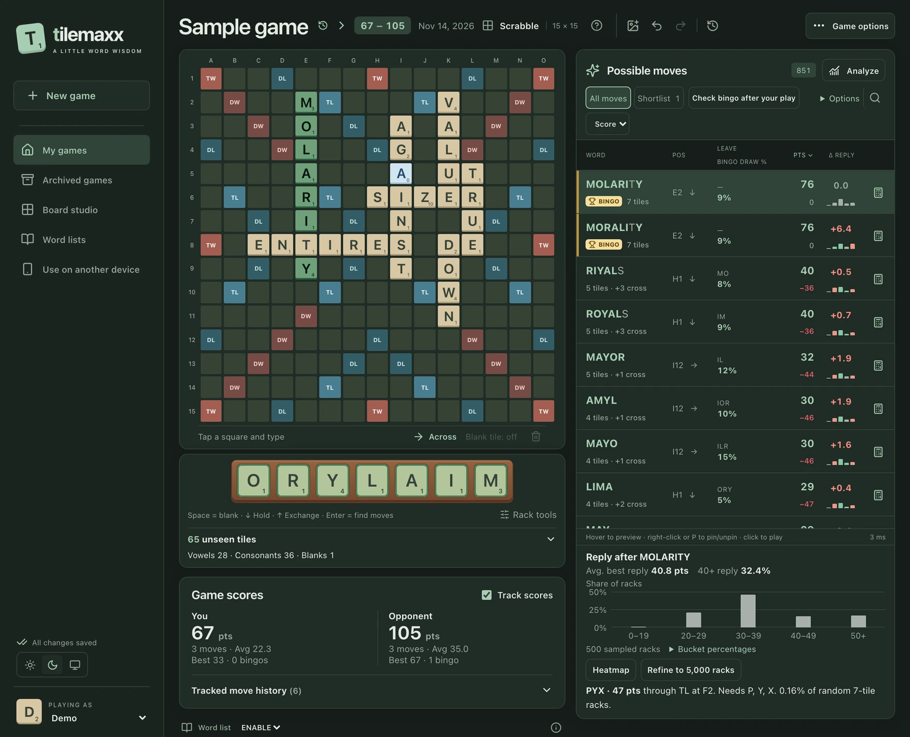
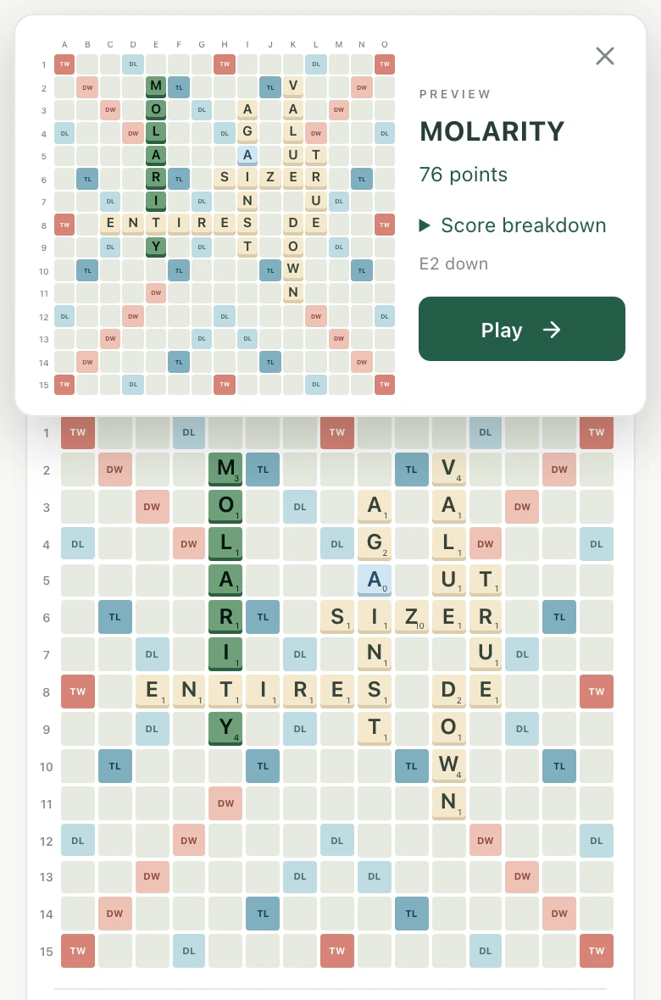
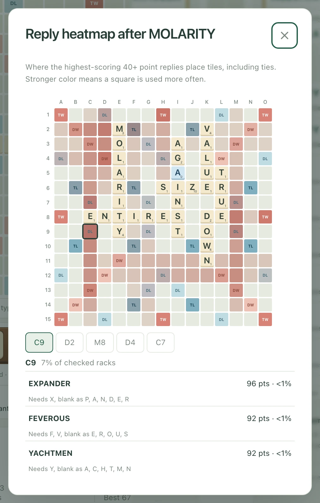

# Tilemaxx

**See what you can play in Scrabble.** Copy in the board and your rack, then browse legal moves, compare scores, and preview where the tiles would go.

Tilemaxx runs on your own computer or home server. Open it in a browser on your computer or phone, and pick up the same game on either device.

[Run locally](#run-locally) · [Deploy with Docker](#deploy-with-docker) · [Word lists](#word-lists)



## Try your first position

1. Open **First game** or choose **New game** to select a layout and word list.
2. Select a board square and type the letters already in play. For a Scrabble GO screenshot, use the image button above the board and check the recognized tiles before accepting them.
3. Enter your rack letters and select **Find moves**. On desktop, hover to preview a move and click to play it. On your phone, tap to preview and then tap **Play**.

After making the move in your actual game, enter the tiles you drew and your opponent’s next move to keep Tilemaxx up to date.

## Beyond the highest score

- **Compare alternatives.** The **Shortlist** surfaces plays worth a closer look. See which tiles each move leaves on your rack, estimate your odds of a bingo (using all your tiles), and check what your opponent might play back.
- **Review your games.** Track scores, revisit a turn with its original board and rack, or use **Review game** to find missed bingos and large score gaps.
- **Play on different boards.** Choose Scrabble, Super Scrabble, or a Words With Friends layout. Use **Board studio** to design your own.

<p>
  <a href="docs/screenshots/phone-preview.webp"></a>
  <a href="docs/screenshots/reply-heatmap.webp"></a>
</p>

<details>
<summary>Board, rack, and game controls</summary>

- **Board.** Select a square and type to advance in the current direction. Use Right or Down to switch direction, or tap the selected square again. Type a dot to skip a square and Space followed by a letter to place a blank. Hover over a played tile or hold it on a phone to check word scores.
- **Rack.** Select any slot to edit it. Space or `?` enters a blank, Delete clears the current slot, and Enter finds moves. Use **Rack tools** to hold tiles out of the search or simulate an exchange. **Unseen tiles** shows the combined tiles in the bag and other racks.
- **Screenshot import.** PNG, JPEG, WebP, HEIF, and HEIC are supported. Adjust the grid if needed and compare the recognized board with the original. Enter the rack separately. Import runs locally, preserves the rack, and can be undone.
- **Analysis.** Use **Analyze** to compare up to three plays. The app estimates bingos and opponent replies from the unseen tiles. Set the bag count in **Options** if you know it. For Scrabble with an empty bag, analysis can search an endgame line.
- **Saved games.** Undo and redo board changes and plays. Switch games from the game title, duplicate a game to try an alternative, or archive a finished game. Wait for **All changes saved** before switching devices. If edits collide, you can keep the server version or save your local version as a separate game.

</details>

## Run locally

Install [Node.js](https://nodejs.org/) 22.13 or later. The project uses Node 24 LTS in CI and Docker. From the checkout, run:

```sh
npm ci
npm run dev
```

Open [http://localhost:4173](http://localhost:4173). On another device on your network, use the host computer’s LAN address with port `4173`. On iPhone, Safari’s **Share → Add to Home Screen** creates a shortcut.

For a production build without Docker:

```sh
npm run build
npm start
```

The defaults are `PORT=4173`, `HOST=0.0.0.0`, and `DATA_DIR=./data`. Set `HOST=127.0.0.1` to limit access to the host computer. Tilemaxx has no login or cloud account. Keep it on a trusted local network and leave its port closed to the internet.

## Word lists

Tilemaxx ships with **Wordnik (2021)** and **ENABLE**, so you can try it right away. Choose a list when you create a game. For league or tournament play, install the list your game uses.

- **WOW24.** Download the [WGPO Official Words 2024 list](https://wordgameplayers.org/wgpo-official-words/) and import it under **Word lists**. You can also save it as `data/dictionaries/WOW24.txt` and restart. New games prefer WOW24 when available.
- **CSW24, NWL, and other lists.** Use **Word lists → Import word list** with a text file you have permission to use, with one word per line. Tilemaxx accepts words from 2 to 25 letters and removes duplicates.
- **Words With Friends.** The layout is available as a preset. The bundled ENABLE list differs from the current Words With Friends lexicon.

Imported lists are available to every profile on the server. Existing games keep their selected list. See [THIRD_PARTY.md](THIRD_PARTY.md) for sources and licenses.

## Deploy with Docker

These steps work on a Synology NAS or another host with Git and Docker Compose. Run them from the folder where you keep your Compose projects.

```sh
git clone https://github.com/buntwo/tilemaxx.git
cd tilemaxx
cp compose.prebuilt.yaml compose.yaml
mkdir -p data
sudo chown 1000:1000 data
```

Uncomment `build: .` in your local `compose.yaml`, then run:

```sh
docker compose up -d --build
```

Open `http://YOUR-HOST-IP:4173` from a device on the same network. If your host uses standalone Compose, substitute `docker-compose` for `docker compose`.

- **Settings.** Set `TILEMAXX_PORT` in a local `.env` file to change the host port. Set `TILEMAXX_CONTAINER_NAME` to override the default `tilemaxx-1` when running multiple instances.
- **Storage.** Compose mounts `./data` at `/app/data`. It contains the SQLite database (`tilewise.sqlite`), imported word lists, and any screenshot examples you explicitly save. The container runs as UID/GID `1000:1000` and needs write access to these files. Git and the Docker build context exclude `data/`.
- **Prebuilt image.** If you already have an image, leave `build: .` commented out, set `image:` to the tag you loaded, and run `docker compose up -d`.

### Update from GitHub

For a checkout-based install with `build: .` enabled, run from the deployment checkout:

```sh
./update.sh
docker compose ps
```

The script fast-forwards the checkout and rebuilds using your local `compose.yaml`. Your settings and bind-mounted `data/` stay in place. With standalone Compose, use:

```sh
git pull --ff-only && docker-compose -f compose.yaml up -d --build --remove-orphans
```

<details>
<summary>Preserve a Compose file from an older checkout</summary>

If `git ls-files compose.yaml` still shows the file, back it up before the pull that removes it from Git:

```sh
compose_backup=$(mktemp ./compose.yaml.backup.XXXXXX) &&
  cp compose.yaml "$compose_backup" &&
  git restore --source=HEAD --staged --worktree -- compose.yaml &&
  git pull --ff-only &&
  mv "$compose_backup" compose.yaml
```

Then run `./update.sh`. If the pull fails, your settings are in `compose.yaml.backup.*`. If you already pulled and the file is gone, copy `compose.prebuilt.yaml` to `compose.yaml` and enable `build: .`.

</details>

### Back up or move your games

Stop Tilemaxx and copy its entire data directory. To restore or move to another host, copy the backup into an empty data directory before starting Tilemaxx. For Docker, run `sudo chown -R 1000:1000 data` from the destination checkout. If moving a Compose install, bring along the local `.env` and any settings in `compose.yaml`. Reconnect your devices to the new server address.

<details>
<summary>Export data from the older <code>tilewise-data</code> Docker volume</summary>

From the old project folder, with an empty `./data` directory:

```sh
mkdir -p data
docker compose stop tilewise
docker cp "$(docker compose ps -a -q tilewise):/app/data/." ./data/
sudo chown -R 1000:1000 data
```

Bring down the old project and use the exported `data/` with the new checkout.

</details>

## Development

```sh
npm run verify       # tests, TypeScript, and production build (also run in CI)
npm run test:unit    # solver, persistence, sync, and OCR
npm run test:ui      # React interaction tests
npm run benchmark   # local solver and analysis timings
```

- [`shared/`](shared/) holds the game rules, scoring, solver, and analysis.
- [`src/`](src/) contains the React interface, local drafts, and browser workers.
- [`server/`](server/) provides the HTTP API and SQLite persistence.

<details>
<summary>Search limits and saving behavior</summary>

Search runs in a browser worker. It stops at two million traversal steps, 150,000 results, or a two-second traversal budget checked periodically. The app reports when a limit is reached and discards partial results. Changing the board, rack, or dictionary cancels the active search.

Browser drafts save immediately, and server writes are debounced by 300 ms. Pending drafts retry after a dropped connection. Opening the app or loading a new dictionary still requires the home server. The `tilewise:` storage keys and `tilewise.sqlite` filename are kept for compatibility with existing saves.

</details>

[License](LICENSE) · [Third-party credits](THIRD_PARTY.md)
